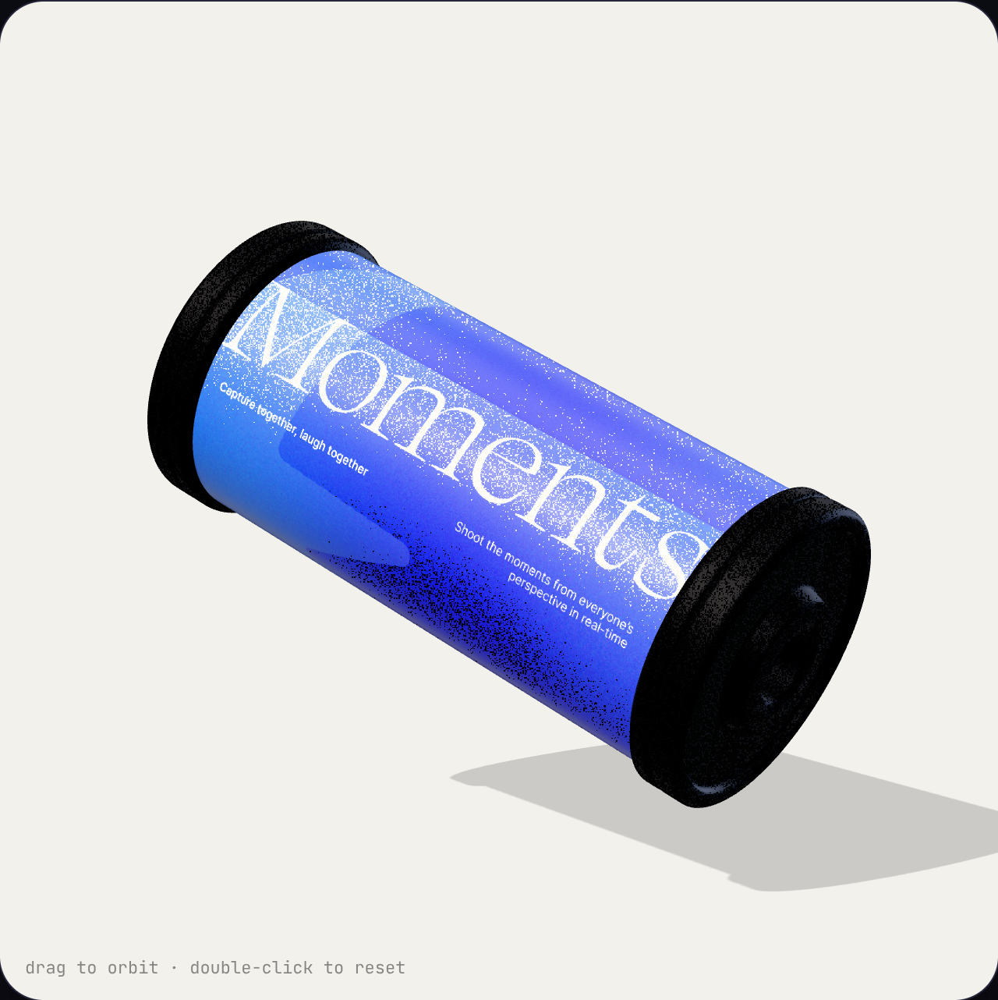
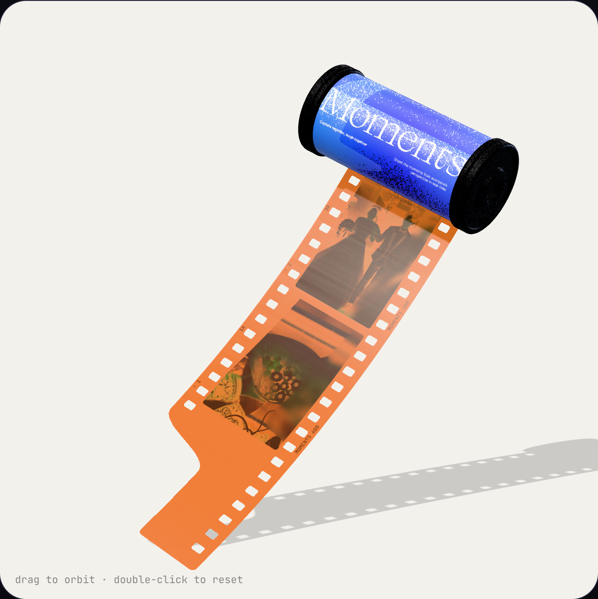

# Film Canister 3D

「Moments」パトローネ（35mmフィルム）の3Dモデル。three.js で手続き生成しています。

| 標準ポーズ | フィルムを引き出したところ |
| --- | --- |
|  |  |

## ファイル

| ファイル | 用途 |
| --- | --- |
| `canister.js` | モデル本体。`createFilmCanister()` で three.js の Group を返す。コマ画像の差し替えAPI付き |
| `assets/label.jpg` | ラベルのアートワーク（幅＝缶の長さ方向） |
| `assets/frame-*.jpg` | コマのサンプル画像 |
| `film-canister.glb` | Web / Spline / Blender など。Idle・Spin・Open・Pull のクリップ入り。フィルムは缶の中にしまった状態 |
| `film-canister.usdz` | iOS（RealityKit / Quick Look）。アニメーションなし。リーダーが少し出た状態 |
| `index.html` | ビューア。アニメーション確認、コマ／ラベル画像の差し替え、GLB / USDZ / PNG 書き出し |
| `build.mjs` | GLB / USDZ / プレビュー画像を再生成 |

## ノード構成

```
FilmCanister   ← 位置・姿勢・浮遊（Idle）
  Spin         ← 缶の軸まわりの回転（Spin）
    Label      ← ラベル
    Lip        ← フィルムの出口（遮光口）
    Film       ← フィルム。three.js では setFilmOut()、GLB ではモーフターゲットで引き出す
    CapTop     ← 上フタ（Open で外れる）
    CapSpool   ← スプール側のフタ
```

1単位 = 缶の直径（約22mm）。缶の軸はローカルの +Y（上フタ側）。

## コマに画像を入れる（three.js）

```js
import { createFilmCanister, FILM } from './canister.js';

const canister = createFilmCanister({
  frames: ['/photos/a.jpg', '/photos/b.jpg', '/photos/c.jpg'], // URL /  / canvas / ImageBitmap
  fit: 'auto',          // 'auto' = 縦長は横倒し（実物のフィルムと同じ） / 'cover' = 正立で切り抜き
  negative: true,       // true = カラーネガ（オレンジベースに反転像） / false = 黒いポジのストリップ
  // label: '/my-label.jpg',
});
await canister.userData.ready;
scene.add(canister);

canister.userData.setFilmOut(FILM.pullOut);       // 引き出す量（0 = しまう）。アニメーションはこの値を動かす
await canister.userData.setFrames([img1, img2]);  // あとから差し替え
```

- コマは `FILM.frames`（6）個。画像が足りない分は繰り返します。
- 引き出しのタイミングは `pullCurve(t)`（0〜`PULL_DURATION` 秒 → 引き出し量）で、ビューアと GLB の Pull クリップが同じカーブを使っています。

## コマに画像を入れる（GLB を他のツールで使う場合）

マテリアル `FilmStrip` のテクスチャを差し替えます。テクスチャの割り付け：

- 横（U）＝ フィルムの長さ方向。U = 0 がリーダーの先端、U = 1 が末尾（全長 `FILM.length` = 12.02）
- 縦（V）＝ フィルムの幅方向
- コマ i（0 始まり）の範囲は `frameRectUV(i)` で取得できます。1コマ目は U ≈ 0.137〜0.274、以降 1コマごとに U += 0.1445、V は 0.157〜0.843
- パーフォレーションとリーダーの切り欠きはアルファで抜いています（alphaTest 0.5）。差し替え画像もアルファ付きPNGにするか、`drawFilmStrip()` で作ったキャンバスを使うのが簡単です

## 再生成

```sh
npx http-server film-canister-3d -p 8123 &
NODE_USE_ENV_PROXY=1 node film-canister-3d/build.mjs
```
